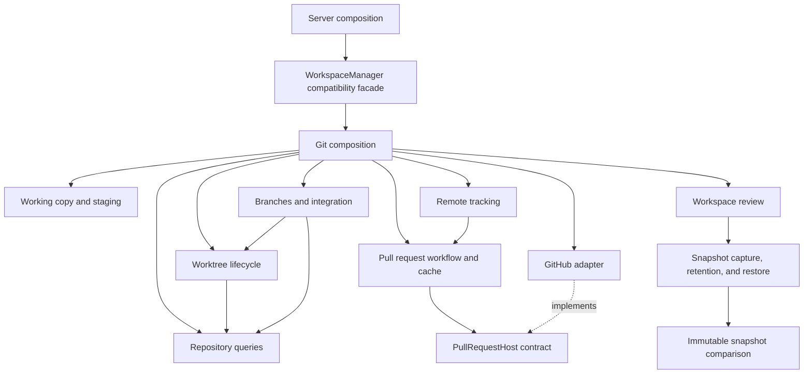

# Git capability and forge ownership audit

CP04 separates Git mechanisms while preserving the existing workspace facade. This audit covers
all production modules under `packages/core/src/git/` and `packages/core/src/forge/`, their
colocated tests, and the Git contracts consumed by server services. The backend-neutral repository
modules retain their CP01 ownership; their session workflow adoption is CP05.

## Composition and dependencies

`git/composition.ts` constructs one set of capabilities around the supplied `GitMutex`. It owns
shared storage configuration and selects the default `GitHubPullRequests` adapter. Callers can
supply another `PullRequestHost`; capability implementations never import the GitHub adapter.

The diagram includes construction and calls. Capability modules cannot import the facade,
composition, public barrel, or concrete forge adapter. The architecture checker enforces these
directions. Forge adapters cannot import Git mutation, persistence, or session implementations.
Immutable comparison cannot import filesystem mutation, the snapshot service, or the mutex.

`capabilities/ports.ts` exposes structural operation contracts without implementation state.
Project opening/repository refresh and session reconciliation consume narrow repository query
ports. Server branch workflows consume the required query, worktree, working-copy, and integration
operations. Server Git commands consume working-copy, integration, remote, and PR ports. Existing
application composition can pass the facade because it satisfies these structural contracts.
Session workspace orchestration now consumes the neutral contracts recorded in
[workspace workflow ownership](workspace-architecture.md).

## Complete production module inventory

Paths below are relative to `packages/core/src/`.

| Module                                   | Owner and accepted responsibility                                                                                                                                                    |
| ---------------------------------------- | ------------------------------------------------------------------------------------------------------------------------------------------------------------------------------------ |
| `git/composition.ts`                     | Construct one capability set, choose the forge adapter, and share storage configuration.                                                                                             |
| `git/worktree-manager.ts`                | Preserve the constructor, method entry points, workspace handle factory, and legacy aliases; delegate Git implementations.                                                           |
| `git/capabilities/ports.ts`              | Public structural contracts; exclude unlocked compound-operation helpers from normal mutation ports.                                                                                 |
| `git/capabilities/types.ts`              | Repository, branch baseline, worktree, workspace handle, and storage configuration data.                                                                                             |
| `git/capabilities/repository-queries.ts` | Repository discovery, unborn/detached branch identity, baseline resolution, and local branch listing. Reads do not reacquire a mutation lock.                                        |
| `git/capabilities/worktree-lifecycle.ts` | Worktree listing/parsing, fresh directory allocation, non-destructive restoration, branch checkout allocation/reuse, copied workspace files, orphan policy, and explicit retirement. |
| `git/capabilities/working-copy.ts`       | Literal path staging/discard, staging all selected-project files, unstaging, and commits with staged-path and hook validation.                                                       |
| `git/capabilities/branch-integration.ts` | Branch creation/checkout, fast-forward refresh, conflict previews, merges, and recoverable squash integration.                                                                       |
| `git/capabilities/workspace-safety.ts`   | Shared unlocked preflight for active Git operations and collisions with ignored files.                                                                                               |
| `git/capabilities/remote-target.ts`      | Resolve configured upstream or the primary remote without locks or caches.                                                                                                           |
| `git/capabilities/remote-tracking.ts`    | Fetch/push/fast-forward pull, branch/upstream counts, and the last successful fetch timestamp; request cached forge information after releasing the local mutation lock.             |
| `git/capabilities/pull-requests.ts`      | Forge remote resolution, bounded shared lookup cache, publication preflight/push, and existing/create PR orchestration.                                                              |
| `git/capabilities/workspace-review.ts`   | Lazy review snapshot owner and compatibility diff/review projection; storage changes reset this owner.                                                                               |
| `git/mutex.ts`                           | FIFO mutation serialization; aborted running work retains its lock until the task settles.                                                                                           |
| `git/snapshot-service.ts`                | Private index context, capture and retention refs, revision pinning, captured review composition, validation, recoverable restore and rollback, and snapshot cleanup.                |
| `git/snapshot-comparison.ts`             | Read pinned trees for statistics, literal-path details, submodule/size limits, and patch formatting without a capture lock or mutable index operations.                              |
| `git/snapshot-types.ts`                  | File patch and immutable comparison results; existing exports remain available through the snapshot service.                                                                         |
| `git/repository-context.ts`              | Canonical selected project, checkout root, Git directory, index path, and nested project scope.                                                                                      |
| `git/repository-backend.ts`              | Translate the neutral repository contract to Git snapshots and validate native immutable IDs.                                                                                        |
| `git/file-safety.ts`                     | Resolve literal workspace paths and reject escape through traversal or symlinks.                                                                                                     |
| `git/utils.ts`                           | Parse Git status/diff output and retain existing Git review data contracts.                                                                                                          |
| `git/text-generation-context.ts`         | Prepare bounded Git context/fingerprints for reviewed commit and PR drafts.                                                                                                          |
| `git/text-generation-settings.ts`        | Select configured text generation provider/model without owning Git or provider lifetimes.                                                                                           |
| `git/session-workspace-operations.ts`    | Backend adapter for allocation, repair, retirement, integration, and guarded discard/recovery; no database/session implementation dependency.                                        |
| `git/legacy-revisions.ts`                | Explicit native-ID export for the legacy Git review API.                                                                                                                             |
| `git/session-workspace.ts`               | Historical constructor compatibility wrapper delegating to the neutral workspace owner; workflow implementation lives in `workspace/session-workspace.ts`.                           |
| `git/index.ts`                           | Retain public Git exports and expose capability composition and operation contracts.                                                                                                 |
| `forge/types.ts`                         | Explicit supported remote identity and PR find/create contracts. No Git locks or mutations.                                                                                          |
| `forge/github-pull-requests.ts`          | Interpret GitHub remote URLs, call the GitHub CLI, and return the browser creation fallback when CLI creation is unavailable.                                                        |

The generic repository files `repository/types.ts`, `repository/repository-service.ts`,
`repository/source-repository.ts`, `repository/identity.ts`, `repository/errors.ts`,
`repository/directory-backend.ts`, and `repository/index.ts` retain the responsibility map in
[Repository architecture](repository-architecture.md). They do not import the Git capabilities.
The directory backend continues to advertise unsupported history/restore explicitly.

## Lock and resource ownership

| Resource                                  | Owner and ordering                                                                                                                                                                                                                               |
| ----------------------------------------- | ------------------------------------------------------------------------------------------------------------------------------------------------------------------------------------------------------------------------------------------------ |
| Repository mutation queue                 | The supplied mutex is shared by all capabilities in one composition. Public mutation methods acquire it once using the canonical repository key supplied by the application.                                                                     |
| Already locked helpers                    | Worktree listing, safety checks, upstream target resolution, and `unstagePaths` perform no lock acquisition. The latter is reserved for existing compound apply/restore workflows and excluded from the regular working-copy port.               |
| Session command lane                      | The existing session command coordinator enters once before Git mutation. Capabilities do not call the session facade or re-enter its lane.                                                                                                      |
| Snapshot private index and retention refs | One `SnapshotService` owns its index namespace and capture/restore mutex. Compound session operations acquire the repository mutation lock before this private-index lock; snapshot code never acquires the repository mutation lock in reverse. |
| Immutable tree reads                      | `GitSnapshotComparison` owns no locks. Capture/pinning completes under the snapshot lock before normal comparison/detail formatting proceeds outside it. Restore validation uses the same reader while the restore owner holds its lock.         |
| PR lookup cache                           | One `GitPullRequests` instance owns bounded, expiring in-flight promises. Tracking and the compatibility facade use the same instance; successful fetch/push/publication invalidates it.                                                         |
| Fetch timestamp                           | One `GitRemoteTracking` instance records successful fetches. A failed fetch does not report a successful refresh.                                                                                                                                |
| Storage path                              | One shared configuration object is read by worktree lifecycle, integration, and review. `setBaseDir` updates that configuration and resets the lazy review owner.                                                                                |
| Forge subprocess                          | The forge adapter owns each CLI invocation and timeout. It never acquires Git locks. PR lookup/create runs after publication preflight and push release the repository lock.                                                                     |

Fetch/push/pull retain the repository mutation lock during their Git subprocesses because refs
and tracking configuration may change. PR metadata requests use the branch and repository URL
captured for that operation and do not hold the local mutation queue during forge requests.
Tracking captures the branch and forge identity together before it leaves the lock.

## Compatibility and safety acceptance

The public facade and `WorktreeManager` alias remain available. GitHub remote parsing is retained
as a compatibility re-export; Git workflows themselves use `PullRequestHost.resolveRemote`.
Unsupported remotes produce `remoteProvider: 'other'`, skip PR discovery, and reject publication
before a push. GitHub CLI creation failure continues to return the explicit `needs_browser`
result. No additional forge implementation or API/database migration is introduced.

Existing Git behavior remains covered: literal Unicode/whitespace/pathspec filenames, traversal
and symlink checks, private-index capture without changing user staging, scoped nested projects,
retained snapshots, recoverable failed restore, fresh worktree allocation, missing-worktree repair,
ignored file retention, dirty/diverged branch protection, conflict resolution, destination races,
hook failure recovery, and retained source history after integration.

CP04 adds regression coverage for injected remote interpretation, unsupported remotes before push,
forge lookup/create outside the mutation lock, shared in-flight lookups and invalidation, failed
fetch timestamps, common mutation serialization, and storage changes across allocation/review/
integration. Existing snapshot concurrency tests now pause the comparison owner directly and
continue to verify captures proceed while immutable statistics or patch formatting is paused.

Verification evidence is recorded in the [migration tracker](architecture-migration.md).
