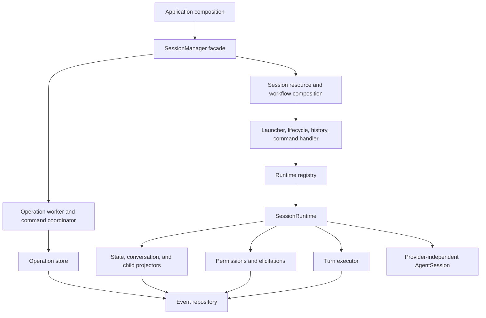

# Session ownership audit

This audit covers every production TypeScript file under `packages/core/src/session`, its README,
and its colocated regression suites. The table below records the accepted owner for all
36 production modules. Existing cohesive modules were reviewed and retained; extraction is
used where composition, persistence, or resource ownership was mixed.

## Dependency and composition rules

`SessionManager` is the application facade. It coordinates public mutations once, delegates
workflow implementation, and exposes application queries. `composition/session-resources.ts`
selects the driver and constructs concrete resources. An injected runtime service takes
precedence without constructing an unused default driver. `composition/session-workflows.ts`
assembles the launcher, lifecycle, history, and command handler. Its late-bound resource access
supports the existing facade integration seams; internal callbacks call their owner directly
and never recursively enter a public command lane.

The diagram shows construction and calls, not reverse imports into the facade. Internal
services declare only the methods they consume through `Pick` contracts. Persistence does
not import workflow, runtime, or projection implementations. The package checker enforces
these directions and forbids direct ACP adapter imports throughout the session layer.

## Complete module inventory

Paths in this table are relative to `packages/core/src/session/`.

| Module                                            | Accepted responsibility and decision                                                                                                                                                                                                                                         |
| ------------------------------------------------- | ---------------------------------------------------------------------------------------------------------------------------------------------------------------------------------------------------------------------------------------------------------------------------- |
| `manager.ts`                                      | Public facade and one acquisition of the command lane; retirement barriers and awaited dispatch shutdown. Concrete resource/default construction moved to composition.                                                                                                       |
| `index.ts`                                        | Explicit package exports: manager, creation/event-bus types, native ID resolver, execution query, and event repository/retention constant. Runtime, request, projector, transcript, and internal contracts are no longer wildcard exports.                                   |
| `contracts.ts`                                    | Narrow event repository, status transition, snapshot, and event-bus ports. No dependency on the facade. Runtime-originated transitions carry an optional runtime identity.                                                                                                   |
| `composition/repository-resources.ts`             | Select the repository catalog and construct the legacy snapshot resource at composition; neutral workflows consume repository/checkpoint ports.                                                                                                                              |
| `composition/session-resources.ts`                | Default driver selection, injected driver precedence, legacy connection-manager attachment, event repository, registry, and workspace construction.                                                                                                                          |
| `composition/session-workflows.ts`                | Workflow dependency/callback assembly without recursive command-lane entry.                                                                                                                                                                                                  |
| `commands/session-command-coordinator.ts`         | Short per-session command lanes; failed commands release their lane. Provider turns remain outside the lane.                                                                                                                                                                 |
| `commands/message-acceptance-service.ts`          | Coalesce simultaneous client retries; validate persisted receipts and original fingerprints after queue edits. Pending promises are released on settlement.                                                                                                                  |
| `commands/message-attachments.ts`                 | Validate and resolve session-scoped attachments before durable acceptance or provider dispatch.                                                                                                                                                                              |
| `commands/session-command-handler.ts`             | Configuration/persona/approval policy and input preparation. Dependencies narrowed to the capabilities it uses.                                                                                                                                                              |
| `execution/session-operation-worker.ts`           | Admission limits, wake/drain lifecycle, accepted-message execution, error classification, queue controls, command receipts, and retirement suspension. Delegates atomic acceptance, selection, claiming, and startup reconciliation to the store.                            |
| `persistence/session-operation-store.ts`          | Synchronous durable acceptance, single-turn claim transaction, queue selection, and startup recovery. No publication, provider calls, or filesystem work inside these transactions.                                                                                          |
| `persistence/session-operation-reconciliation.ts` | SQL policy shared by the store and history repository: removed history cancels its still-open operations and attempts atomically. Moved out of execution to its persistence owner.                                                                                           |
| `execution/session-turn-executor.ts`              | Prepare and execute one turn, manual MCP invocation, skill/context delivery, snapshots, usage, correlated diagnostics, and guarded finalization. This orchestrator deliberately owns turn sequencing.                                                                        |
| `execution/session-execution-state.ts`            | Transactional read model of connection, execution, attention, queue, and latest attempt diagnostics. No dispatch or repair.                                                                                                                                                  |
| `execution/session-failure-stage.ts`              | Derive failure stage from persisted dispatch/acceptance evidence.                                                                                                                                                                                                            |
| `execution/turn-diagnostics.ts`                   | Pure monotonic phase timing and output recognition.                                                                                                                                                                                                                          |
| `execution/skill-catalog-delivery.ts`             | Skill delivery receipts scoped by local session, provider, native session and catalog hash; compaction invalidation.                                                                                                                                                         |
| `persistence/session-event-repository.ts`         | Event validation; atomic row, token and cursor writes; publication after commit; history backup/restore and change retention. Event-bus type moved out of the facade.                                                                                                        |
| `projection/conversation-projector.ts`            | Provider conversation policy: identities, user echoes, text/thought streaming, tool merges, null clearing, correlation and finalization. Bounded message/tool caches; persisted identity fallback. Flush previous output before resetting a turn.                            |
| `projection/session-state-projector.ts`           | Root session settings/usage/plan projection and dispatch to conversation/child owners. Recheck runtime ownership after asynchronous reads before writing replacement-sensitive state.                                                                                        |
| `projection/subagent-projector.ts`                | Runtime-scoped child associations, conversation/message identities, child output and terminal projection. Child settings/usage cannot mutate the root session settings.                                                                                                      |
| `runtime/session-runtime-registry.ts`             | Live runtime ownership, typed compatibility-status transition validation/effects, startup replay/configuration, binding registration, and registry-wide shutdown. Initializing runtimes own callbacks but remain unavailable to application queries until binding completes. |
| `runtime/session-runtime.ts`                      | One provider handle, binding/attempt association, callbacks, turn/request owners, terminal input, and idempotent cleanup. Binding and initialized persona persistence share a transaction.                                                                                   |
| `requests/session-permission-controller.ts`       | Policy evaluation, native permission choices, grants, approval rows and request waiters. Epoch, cancellation and runtime identity guards prevent stale approval resumption.                                                                                                  |
| `requests/elicitation-registry.ts`                | Request-specific form validation and settlement. Reject duplicate pending IDs; retain at most 200 settled items and 100 pending requests without evicting active waiters.                                                                                                    |
| `requests/request-cancellation.ts`                | One abort listener and waiter per request; explicit disposal.                                                                                                                                                                                                                |
| `services/session-launcher.ts`                    | Workspace availability, provider selection/launch configuration, start/restart and coalesced resuscitation. Retained owner; dependencies narrowed.                                                                                                                           |
| `services/session-lifecycle-service.ts`           | Workspace mode, archive, deletion, finalization and orphan synchronization; provider-native deletion best effort. Retained owner; dependencies narrowed.                                                                                                                     |
| `services/session-history-service.ts`             | Fork, rewind/undo and handoff orchestration; stop and flush runtime before history mutation. Retained owner; dependencies narrowed.                                                                                                                                          |
| `agent-session-id.ts`                             | Pure native-session ID compatibility decoding and provider selection.                                                                                                                                                                                                        |
| `context-budget.ts`                               | Pure byte budgeting and recent context selection.                                                                                                                                                                                                                            |
| `context-files.ts`                                | Session-scoped canonical-path grants for generated context files; expiry and a 500-entry bound.                                                                                                                                                                              |
| `history-transcript.ts`                           | Persisted transcript selection, delivery filtering, context budget and private overflow document creation.                                                                                                                                                                   |
| `handoff.ts`                                      | Handoff document policy and associated private-file/Git context I/O; redaction, retention and unreferenced timer cleanup. Workspace context is injected through backend-neutral review capabilities after CP05; no Git subprocess remains.                                   |
| `stream-buffer.ts`                                | Coalesced persistence timers, serialized writes, awaited in-flight flush, observable errors, retryable pending content, and generation-safe reset.                                                                                                                           |

## State and operation owners

The persisted operation and attempt status unions remain the source of typed transitions;
CP03 adds no parallel state-machine framework or schema. The registry retains its explicit
`Record<SessionStatus, SessionStatus[]>` compatibility transition table. Connection, attempt,
and attention remain independent dimensions in `readSessionExecutionState`.

| Trigger                          | Owner                                         | Durable effect / invariant                                                                                                                                                                   |
| -------------------------------- | --------------------------------------------- | -------------------------------------------------------------------------------------------------------------------------------------------------------------------------------------------- |
| New client command               | Acceptance service → worker → operation store | Validate first; one transaction inserts the user row, operation `pending`, attempt `queued`, tokens and cursor; publish after commit. Stable command ID/fingerprint acknowledges duplicates. |
| Dispatch                         | Worker → operation store → turn executor      | An immediate transaction claims `pending → running` and `queued → running`; unresolved/running work blocks later dispatch. Only one turn per session.                                        |
| Permission wait / resolution     | Permission controller                         | `running ↔ waiting` only for a still-active attempt. Native choice meanings are preserved. Stop and approvals bypass the turn lane.                                                          |
| Provider completion/failure      | Turn executor → worker                        | Preserve explicit cancellation/failure/unknown outcomes. Worker owns the durable delivery classification and correlated visible failure for accepted messages.                               |
| Restart                          | Operation store → worker                      | Retire connected bindings as `lost`. A running send with no `dispatchedAt` returns to `pending/queued`; dispatched or unprovable work becomes `unknown` and is never automatically resent.   |
| Queue edit/reorder/cancel/resume | Worker command lane                           | Edits preserve original acceptance receipts; unknown delivery must be resolved before reorder/resume. Removed history cancels its open operations.                                           |
| Archive/delete/finalize          | Manager → worker → lifecycle                  | Suspend dispatch, cancel outstanding messages, close runtime, await active dispatch, then mutate workspace. Failed retirement releases suspension.                                           |
| Runtime replacement              | Registry                                      | Exact runtime UUID owns callbacks. Detaching a runtime revokes ownership. Old shutdown completion removes only its captured instance, preserving any replacement.                            |
| Application shutdown             | Manager → registry/runtime                    | Stop admission, release request waiters before I/O, attempt every resource cleanup, await dispatch settlement and propagate aggregated cleanup errors.                                       |

## Resource and persistence invariants

The event repository, operation store, turn store and acceptance service own fixed prepared query
sets in `persistence/session-event-statements.ts`, `persistence/session-operation-statements.ts`,
`persistence/session-turn-statements.ts` and `persistence/session-receipt-statements.ts`.
`SessionRuntime` shares one turn store with dispatch, turn execution and skill-catalog delivery.
Only query shapes are retained: session/provider settings, receipts and compaction state are read
fresh each time, with projections limited to fields the workflow needs. Scoped rewind reconciliation
also reuses its statement, with the same transaction and attempt-cancellation policy as recovery.
Each set belongs to its owner's database connection; no global SQL-string cache is used.
Values, nullable fields and update timestamps are rebound on execution. Date placeholders use
column encoders. Caller-owned synchronous transactions on that same connection include prepared
writes, preserving acceptance/claim rollback boundaries; event publication still follows commit.
Retention policy and uncertain-delivery checks are unchanged. Tests cover reuse without additional
native preparation, rollback/retry, rebinding and independent database connections.

Permissions and elicitations belong to a single runtime and request. Stop, provider close,
replacement, and cancellation release their waiters. A failed elicitation publication also
settles its waiter. Abort listeners are disposed. Terminal input is accepted only by the
current live runtime; terminal output is projected from its provider-independent events.
The provider handle owns its terminal processes and closes them with the connection. Host
interactive terminals and WebSocket/SSE subscription resources remain server-owned (CP02).

`SessionRuntime.stop()` shares one shutdown promise and one provider-close promise. It revokes
callbacks before awaiting a flush. Flush or close failure cannot skip binding closure, waiter
release, or guarded session-status cleanup. Registry shutdown attempts every captured owner,
reports failures, and cannot clear a newly installed replacement.

Conversation row mutations, metadata/token changes and change cursors commit together.
Snapshots and cursor high-water marks use the server query layer's shared read transaction.
Cursor retention remains 10,000 changes per session, with bounded snapshot fallback for
older clients. Streaming deltas remain transient; full persisted rows and live snapshots
support catch-up. Failed background flushes are logged and keep pending content for explicit
retry; explicit flush waits for an already-started write and reports persistence failure.

The system assumes **one owning server process per database**. This migration does not introduce
leases, cross-process runtime ownership, automatic resend of uncertain turns, or a new
protocol. Repository-neutral snapshot/workspace workflow acceptance is recorded in
[the workspace audit](workspace-architecture.md); [provider and ACP lifecycle ownership](provider-architecture.md)
records protocol composition, cancellation and shared connection disposal.

## Verification

The session and server suites cover durable duplicate acceptance, dispatch order, independent
session lanes, unknown delivery/restart recovery, queue edits, command receipts, Stop/approval
bypass, retirement barriers, rollback, null clearing, replay, reconnect/cursor catch-up and
subagent isolation. The new ownership suite additionally exercises stale callbacks and
in-flight projection, failed cleanup, replacement during shutdown, and failed elicitation
publication. Stream-buffer tests exercise write ordering, waiting and retry after failure;
elicitation tests cover duplicate IDs, pending capacity and settled retention.

The [migration tracker](architecture-migration.md#cp03--session-execution-persistence-and-runtime-ownership)
retains the original session evidence; its final closure section records repository-wide acceptance. Public module visibility
was narrowed deliberately: server fixtures now import the internal elicitation registry
directly; application code continues through the facade and execution query. No HTTP contract
or database schema change is introduced.

## Context occupancy and token consumption

`sessions.contextUsedTokens` is the latest current-context occupancy reported by an ACP
`usage_update`. It is separate from `totalTokens`, transcript token estimates, and the
provider's prompt-result consumption metrics. Only a context report writes occupancy;
finishing a turn, processing cached input, or recalculating transcript estimates cannot
overwrite it. `sessionMetrics.lastTurn` exposes the provider's separate processing counts
without deriving occupancy or assuming cache accounting is identical across providers.

Occupancy is nullable: providers without a current report show **Unavailable**, even if
their processing totals and maximum context capacity are known. A reported zero is valid.
An unknown capacity does not borrow a historical metrics limit to produce a percentage.
New turns, compaction, model/provider switches and native reconnects invalidate the old
occupancy until the provider reports it again. ACP v1 and v2 share the same projection and
meter; this does not depend on a provider name or an optional native API.

Migration `0057_context_occupancy` adds the nullable field. Historical processing totals
are preserved and never backfilled as context usage. The historical `usage_update` event's
`totalTokens` alias is retained for compatibility alongside the explicit `contextUsedTokens`
field; it is not a consumption counter. Saved occupancy survives a database reopen, while
a new native connection must report its own state.

Session costs are saved as nullable `sessionMetrics.reportedCost` snapshots with the
agent's amount and currency. Repeated session reports replace the snapshot rather than
adding it; a later report without cost preserves the last known report. Prompt-result
costs are retained separately in `sessionMetrics.lastTurn.cost`. Neither is added to the
other or converted into the legacy currency-less `estimatedCost`. Missing, malformed or
currency-less costs remain unknown; an explicitly reported zero remains known. The meter
displays session and last-turn costs separately and never defaults the currency to USD.

Native startup, normal resume and native import capture the latest usage report while
initialization is in progress. The buffer holds only one report, retaining the latest
valid cost if a later report omits it. Compaction or a model change invalidates an earlier
buffered report. After configuration and binding, the installed runtime applies the report
through its normal ownership guard before accepting live reports. Failed startup never
publishes buffered usage. Starting a native connection clears its old session cost until
a fresh report arrives; replayed conversation consumption never becomes occupancy.
