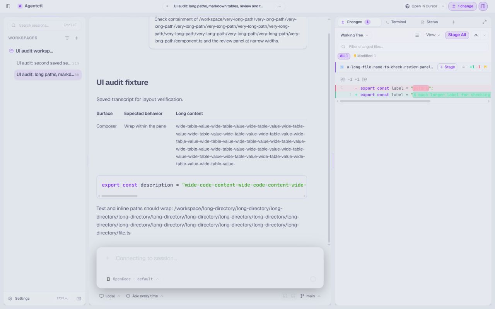
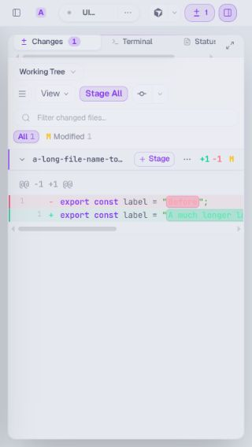

# UI consistency checklist

Preserve the existing visual direction. Use shared components before introducing local styles.

## Shape and containment rules

- `rounded-md`: inputs, selects, buttons, and inset code surfaces.
- `rounded-lg`: cards, panels, and grouped controls.
- `rounded-xl`: dialogs and composers. Nested surfaces use a smaller radius.
- Full rounding is reserved for pills, switches, circular controls, and status dots.
- Decorative highlights follow the owning surface's radius.
- Flex/grid content can shrink: use `min-w-0` and, for vertical scroll layouts, `min-h-0`.
- Prose and inline paths wrap. Code and tables scroll within their own focusable containers.
- Actions wrap based on available space, including in a narrow panel on a wide window.
- Markdown colors come from theme tokens, including light themes.
- Popovers, menus, and tooltips respect viewport padding. Tall overlays scroll inside
  the available height; long labels wrap within the overlay.
- Modal commands trap keyboard focus and return it to the previous control when dismissed.
- Request cards have unique label IDs. Scrolling their details must not trigger approval navigation.

## Reproductions covered by the gallery

| Area          | Stress case                                 | Expected result                                                       |
| ------------- | ------------------------------------------- | --------------------------------------------------------------------- |
| Select        | Long directory path                         | Trigger truncates; menu wraps; full selection is available on hover.  |
| User message  | Edit in a 240px panel                       | Editor and action buttons stay inside the bubble.                     |
| Markdown      | Long paths, inline code, wide tables        | Prose wraps; code/table scroll independently.                         |
| Composer      | Long input and file drop overlay            | Input fits; overlay uses the composer radius.                         |
| MCP form      | Long remote-type label and footer actions   | Rows wrap without clipping controls.                                  |
| MCP card      | Long name, expanded details, enable switch  | Name stays readable; actions wrap; enable does not expand.            |
| Font settings | Narrow panel and large UI font              | Labels, font picker, and size controls stay contained.                |
| Dialog        | Content taller than the window              | Dialog stays inside viewport padding and scrolls vertically.          |
| Overlays      | 380px popover/menu in a phone viewport      | Width is capped; menu navigation scrolls to the selected item.        |
| Tooltip       | Long directory path                         | Full text wraps inside the viewport.                                  |
| Tool output   | Long lines and 24 output rows               | Keyboard scrolls locally; the copy action stays visible.              |
| Requests      | Long tool name, request ID, and field label | Headers and actions wrap; labels target the correct request's input.  |
| Suggestions   | Long command/file names in a short window   | Menu follows the composer, fits the viewport, and keeps typing focus. |

Check the gallery at 320×568 and 1280×800, with 240px/360px/640px panels, 13px/20px
UI font sizes, and Mocha/Latte themes. Also check a short 900×360 window. Exercise keyboard
focus, dropdown selection, message edit/cancel/save, code/table scrolling, and streaming.
Use “Show request cards” to mount pending approval and input requests; all response actions
update local fixture state. Opening this section focuses Deny, matching live request behavior.
Use “Composer suggestions” to preview slash commands and context results, then focus the input
to bring the composer into view. Command arrows/Tab and clicking context results update the fixture.

The gallery uses real components with local fixture state and disabled API queries. It does
not replace a live-session pass through the sidebar, review panel, terminal, or setup flow.

## Workspace audit

The workspace pass uses an isolated temporary database, a saved transcript with long paths,
a wide table/code block, and a disposable Git repository with a real modified file. No agent
prompt is sent. Sidebar, chat, settings, review, and a connected interactive terminal were
checked at 1280×800, 680×568, and 320×568.

- Malformed JSON and null/invalid agent lists become retryable errors in setup and provider
  settings. Valid empty lists still work. A regression test covers recovery after retry.
- Syntax highlighting uses theme tokens throughout; the dark-only stylesheet no longer
  overrides colors in light mode.
- Below 1024px, the desktop sidebar leaves the resizable layout. The inspector uses the
  full work area, and its toggle stays visible in the compact header. Closed panels are inert.
- Narrow terminal panes hide the fixed-width tabs sidebar and offer a terminal selection
  menu. Wider panes retain the tabs sidebar; its header actions wrap.
- Long session titles truncate within the header, including while editing. Review toolbar
  actions wrap within narrow panes. Code blocks scroll with keyboard arrows without moving
  the whole page horizontally.

The live UI audit verifies a saved session and local terminal connection. Agent streaming
and composer stress states are covered by the gallery and component tests.

## Final workflow review

The final pass exercised switching between two saved sessions, editing and cancelling a
prompt, expanding a changed-file diff, changing diff display options, connecting a terminal,
opening another terminal, and splitting the terminal pane. Settings were checked in light
and dark modes and at a 20px UI font in a 320×568 viewport, then restored to light/13px.

Closing the mobile inspector now returns to the chat without a panel mount callback reopening
it. Switching back to desktop registers a fresh panel group and collapses the closed inspector,
so the chat regains the available width without a panel-constraint error.

Older conversation pages load automatically when scrolling upward near the beginning of the
loaded history. The feed preserves the visible message as pages are prepended, shows a quiet
loading status at the history boundary, and offers Retry only after a failed request.

The turn timeline uses a complete index of foreground user prompts, independently of the
loaded message pages. Tick count and turn numbering stay fixed as history loads. Selecting
an unloaded turn fetches the required older pages and navigates to that input. Loaded turns
retain their detailed previews; unloaded turns show their prompt without an invented response
summary. The rail compresses to fit the chat height and previews respect viewport bounds.
An isolated 500-message conversation showed all 250 ticks before its older pages loaded;
first/last-turn navigation and rail containment were checked on desktop and at 320×568.

These screenshots use disposable fixture data:

## Remaining surfaces

- Shared popover/menu/tooltip bounds cover the model picker, thinking effort, context,
  advanced configuration, and other consumers. Floating surfaces use the shared panel radius.
- Raw tool output and diff patches have focusable horizontal/vertical scrolling; copy buttons
  sit outside the scrolling text. Tool and warning colors follow the current theme.
- Approval and input request headers/actions wrap. Each request owns its accessible title and
  field labels, including when two requests use the same field name.
- Quick launch stacks its two configuration fields on phones and uses the shared control corners.
  Provider model and credential rows can shrink and wrap. Registry warnings use theme colors.
- The command palette uses the shared modal with bounded height, a scrolling results list,
  focus trapping, Escape dismissal, and focus restoration. Toasts use theme text and viewport bounds.
- Slash-command and context suggestions use the composer as a floating anchor, flip when necessary,
  and bound their scrolling list to the available viewport height without moving typing focus.

## Session sidebar composition

The sidebar uses the existing typography, icon, control and motion roles and retains the shared
glass surfaces and Catppuccin themes. Session titles share a fixed unread gutter, provider logos
use a muted theme backing, and branch details retain space when activity labels wrap. Project
actions appear above the header on interaction instead of reserving space while hidden.

Filter and sort uses the shared Dropdown with checked menu items, keyboard navigation, Escape
dismissal and focus restoration. Search, session actions and footer controls reuse the existing
SearchBar, Button, IconButton and Kbd components. Sidebar disclosure controls stay geometrically
stable; live working/loading indicators retain reduced-motion support.

An isolated browser fixture using the real sidebar components was checked in Mocha and Latte,
at 280px and 240px sidebar widths and 13px/20px UI font settings. The check covered long titles,
branch truncation, pending activity, pinning, search results and keyboard filtering. No shared UI
foundation or primitive implementation changed during this pass.

Sidebar groups use spacing and labels rather than a vertical tree line. Project names, Pinned,
Active and Settled labels, session titles and the Settings label share the same icon/text gutters.
Session and project action buttons share their right inset; nested groups keep the full row width.

## Loading feedback consistency

Application loaders compose the shared Spinner, LoadingState, LoadingSkeleton, SkeletonSurface and
Progress primitives. The gallery's Loading patterns section covers content placeholders, local
status, busy controls and measured/indeterminate progress. Existing agent-thinking and streaming
indicators retain their own semantics.

Browser checks covered Mocha at 13px UI text and Latte at 20px, including a 390px viewport.
Busy and idle Save preferences controls retained identical dimensions and labels. Content and
progress stayed contained; Settings and provider-authentication loading frames kept their close
controls, and Escape dismissed both. Dedicated regressions cover polite status ownership,
decorative placeholders, progress bounds, duplicate-click prevention, focus preservation and
closing before deferred content is ready.

SkeletonSurface now masks the actual settings, provider/MCP/setup, authentication, sidebar and
review presentation trees. Buttons, text, icons and conditional sections create placeholders
automatically; no second control tree is maintained. Local UI state remains mounted when a
surface is revealed. LoadingSkeleton groups remain for accessible pending lists and share nested
status ownership with automatic surfaces. Unused manual shape/text primitives are removed.

An isolated browser fixture added a conditional section with a new button: the mask count changed
from three to five while the pending and loaded presentations retained identical heights. Real
General, Providers and MCP settings views kept one accessible status and stayed contained in a
390px viewport at 20px text in Latte; Mocha/13px was also checked. Sidebar and review rows were
visually inspected. Unknown server conditions, text lengths and list counts still use safe defaults.
